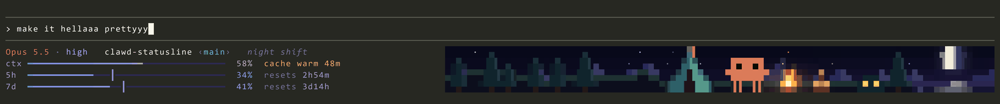
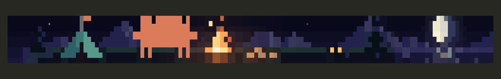
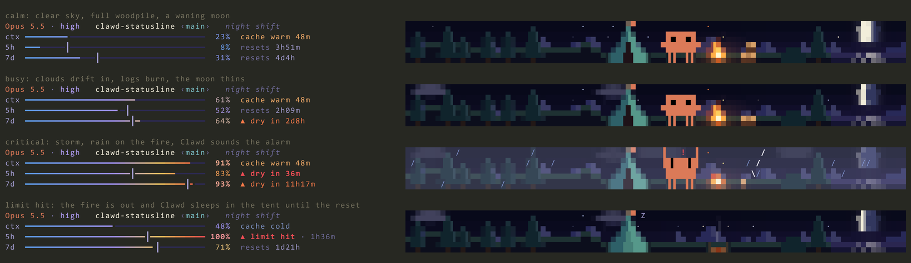
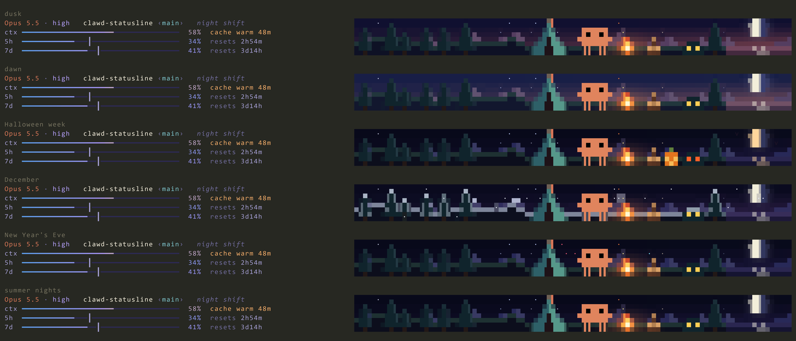
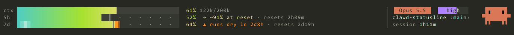
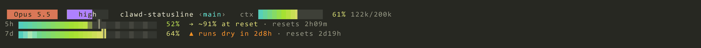

<h1 align="center">clawd-statusline</h1>

<p align="center">
  <b>An animated status line for Claude Code.</b><br>
  Three styles. One of them is a whole campsite.
</p>

<p align="center">
  
</p>

<p align="center">
  
</p>

<p align="center">
  <sub>One Python file &nbsp;·&nbsp; standard library only &nbsp;·&nbsp; about 100 ms a frame &nbsp;·&nbsp; nothing leaves your machine</sub>
</p>

---

## 🔥 campfire

Four rows. On the left, the numbers, in the colours of the night: the model, the folder, and a thin
bar each for the context, the 5-hour and the 7-day window, each with one note (the cache, or when it resets).
On the right, Clawd has set up camp. Nothing in the scene is decoration: every part of it is a reading.

| In the scene | It shows |
|---|---|
| ✨ **Stars** | The context window. More stars switch on as it fills, and a compaction clears the sky. |
| 🔥 **The fire** | The prompt cache. It roars after a request, burns down as the cache ages, and is embers once it has gone cold. |
| 🪵 **The woodpile** | The 5-hour window: five logs, and one burns for every fifth of the budget you use. |
| 🌔 **The moon** | The 7-day window. Full when the week is fresh, waning as you use it. |
| ☁️ **Weather** | How things are going. Clouds drift in when a meter needs watching; a storm rains on the fire when one is critical. |
| 🌅 **The sky** | Your clock. Dusk glows at sunset, dawn glows in the morning, and the night is deep blue. |
| ⛺ **The tent** | A limit is hit. The fire goes out and Clawd sleeps in the tent until the reset. |

<p align="center">
  
</p>

### The small things

Keep it open for a while and you will catch them.

- Clawd blinks, looks around and taps along. Every so often it roasts a marshmallow over the fire, and sometimes the marshmallow catches.
- When a shooting star crosses the sky, Clawd waves at it.
- The flag on the tent flutters, sparks fly off the fire, and a dying fire smokes.
- Something lives in the bush. You can see its eyes blink.
- The moon lays a shimmering path across the lake, and its light catches the edges of the pines.
- After a compaction or a fresh 5-hour window, a note appears for a few seconds: *the sky clears*, *woodpile restocked*.
- Critical numbers pulse, and a `┃` on each window's bar shows how far through the window you are. If you would run dry before the reset, the note says when.

The camp also keeps a calendar. Some of it is below; the rest you will have to find.

<p align="center">
  
</p>

## 📊 dashboard

Context, 5-hour and 7-day bars in one column, so they line up and compare at a glance. A panel on the right
says who (model, effort), where (folder, branch) and how long, with Clawd beside it, reading the room.

<p align="center">
  
</p>

## 💊 chips

The same bars, with the model and effort drawn as chips on a head row above them.

<p align="center">
  
</p>

### Reading the bars

- **Colour** is heat. A fuller bar reaches further into the hot end of the gradient.
- **`┃`** is *now*: how far through the window you are. Fill to the left of it is on pace; fill past it is budget borrowed from later in the window.
- **The forecast** after each bar (`→ ~81%`) is where you will be at the reset at your current pace. If you would run dry first, it says when (`▲ dry in 2d8h`).

## Install

You need Python 3.9 or newer. There is nothing to install with pip.

1. Clone the repository somewhere permanent:

   ```sh
   git clone https://github.com/MagicJosh/clawd-statusline.git
   ```

2. Point Claude Code at it in `~/.claude/settings.json`:

   ```json
   {
     "statusLine": {
       "type": "command",
       "command": "python3 -I -S /path/to/clawd-statusline/statusline.py",
       "refreshInterval": 2
     }
   }
   ```

   On Windows, use `python` and a forward-slash path, such as `"python -I -S \"C:/tools/clawd-statusline/statusline.py\""`.

   `refreshInterval` is what makes it move. Keep it equal to `REFRESH` at the top of `statusline.py` (2 seconds), or the animations stall between frames.

3. Pick a style:

   ```sh
   python3 statusline.py --use campfire     # or dashboard, or chips
   ```

   The choice is saved in `~/.claude/statusline-style` and takes effect on the next frame.

### Try it first

```sh
python3 statusline.py --demo campfire    # animated preview with fake data; q to quit
python3 statusline.py --gallery          # every style in fresh, calm, busy and critical states
python3 statusline.py --selftest         # edge-case checks, exits 1 on failure
```

### Width

Each style fits itself to the terminal. The campfire shows the full camp from about 120 columns
(its forest grows until about 160), a smaller camp from about 90, and just the numbers below that.

## Terminal support

The campfire needs no special font and no terminal setting. Its pixels are the half blocks `▀` and `▌`,
two colours per cell, and its bars are `━` lines. Plain Consolas (the Windows default) and Cascadia Code
and Mono have every glyph it prints, and `--selftest` fails if it ever prints one outside that set.
A few older fonts (Courier New, Lucida Console) lack `━`.

The dashboard's Clawd and the chips' bars use quarter and eighth blocks (`▟`, `▆`). VS Code draws those
itself while GPU acceleration is active; otherwise they come from a fallback font and can sit slightly off.

The colours are tuned for a dark theme.

## How it works

- Claude Code sends the session as JSON on stdin every `refreshInterval` seconds. The script prints its rows (three, or four for the campfire) and exits.
- The campfire scene is a canvas of pixels, 2 across and 2 down per cell. Each cell shows its four pixels as one colour, top over bottom (`▀`) or left beside right (`▌`), whichever fits them best, and the art is drawn so its edges fall on those halves. Stars, sparks, rain and snow are text glyphs laid on top, taking the sky's colour behind them.
- Animation is a frame counter derived from the clock. Every random choice is a hash of that counter, so nothing flickers between renders.
- A few small state files in your temp folder remember recent readings, which is how it notices a compaction or a fresh window.
- It reads `git` metadata from the `.git` folder directly, and makes no network calls.

## Regenerating the images

The GIFs and screenshots in `docs/` come from `tools/snapshot.py`, which renders the real output
with block glyphs drawn as shapes, so the images stay crisp whatever font is installed.

```sh
pip install pillow
python tools/snapshot.py              # everything
python tools/snapshot.py calendar     # one job
```

## License

[MIT](LICENSE)

<sub>Unofficial. Claude, Claude Code and Clawd belong to Anthropic; this is a fan project, not made or endorsed by Anthropic.</sub>
